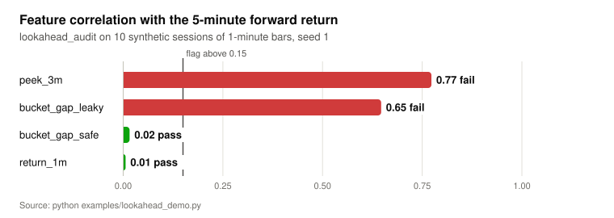
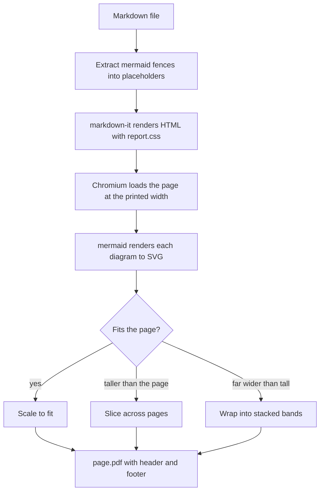
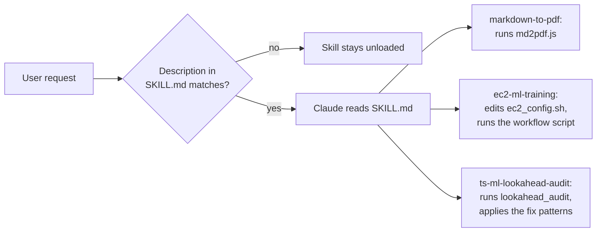
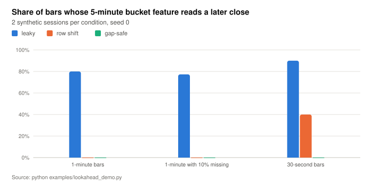

# claude-skills

Three Claude Code skills: Markdown to paginated PDF with vector mermaid diagrams, EC2 offload guidance for ML training, and a look-ahead bias audit for time-series datasets.

<!-- chart: audit-correlations -->
<picture>
  <source media="(prefers-color-scheme: dark)" srcset="docs/figures/audit-correlations-dark.svg">
  
</picture>

<details><summary>Data table</summary>

| Item | Value |
|---|---|
| peek_3m | 0.77 (fail) |
| bucket_gap_leaky | 0.65 (fail) |
| bucket_gap_safe | 0.02 (pass) |
| return_1m | 0.01 (pass) |

Source: `python examples/lookahead_demo.py`

</details>

## What it does

- `markdown-to-pdf` renders a Markdown file to PDF in headless Chromium. Diagrams taller than a page are sliced across pages, diagrams far wider than tall are wrapped into bands, and table headers repeat on every page.
- `ec2-ml-training` tells Claude how to move a training run that does not fit in local RAM onto a short-lived EC2 instance: instance and algorithm choice, the config and workflow script split, S3 transfer, termination rules.
- `ts-ml-lookahead-audit` tells Claude how to find features that see the future in a time-series dataset, with a correlation audit and leak-free versions of two common resample and merge patterns.
- Tests cover the shipped code: three smoke tests run the PDF renderer in Chromium, and the look-ahead tests execute the Python blocks of its `SKILL.md` as written.

## Install

A skill is a folder with a `SKILL.md`. Copy or symlink a folder from `skills/` into your personal skills directory, or into a project's `.claude/skills/` to scope it to that project.

```bash
git clone https://github.com/darblinko/claude-skills
mkdir -p ~/.claude/skills
cp -r claude-skills/skills/markdown-to-pdf ~/.claude/skills/
# or keep it updatable from the clone:
ln -s "$PWD/claude-skills/skills/ts-ml-lookahead-audit" ~/.claude/skills/ts-ml-lookahead-audit
```

Start a new Claude Code session after installing a skill. `markdown-to-pdf` also needs Node.js 20.19 or later and a Chromium build; see its README.

## Skills

### markdown-to-pdf

[skills/markdown-to-pdf/README.md](skills/markdown-to-pdf/README.md)

Renders Markdown to a print-quality PDF. Mermaid diagrams are drawn as SVG and keep their labels readable: a diagram taller than the page is sliced into page-height windows, and one far wider than tall is cut into stacked bands. Every page gets a running header (`--note` sets the right-hand text) and a `Page N of M` footer. Rendering is local.

```bash
node ~/.claude/skills/markdown-to-pdf/md2pdf.js report.md report.pdf --note "Draft"
```

The render pipeline, from `skills/markdown-to-pdf/md2pdf.js`:



### ec2-ml-training

[skills/ec2-ml-training/README.md](skills/ec2-ml-training/README.md)

Guidance only; no code ships with it. It defines a two-script interface (`scripts/ec2_config.sh` holds every value, `scripts/ec2_training.sh` holds the lifecycle) and covers instance sizing, GPU support in XGBoost, LightGBM and CatBoost with a rule to benchmark CPU against GPU, the XGBoost move from `gpu_hist` (deprecated in 2.0, removed in 3.1) to `device="cuda"`, AMI lookup, the `scp -r` nesting failure and cost rules.

### ts-ml-lookahead-audit

[skills/ts-ml-lookahead-audit/README.md](skills/ts-ml-lookahead-audit/README.md)

A correlation audit (`lookahead_audit`) plus leaky and leak-free versions of bucket resampling and daily merges. The skill is model-invoked only (`user-invocable: false`): Claude applies it while building or reviewing a time-series dataset.

## How it works



Claude Code reads only the `name` and `description` frontmatter of each installed skill until a request matches one; then it loads the full `SKILL.md`. Files next to `SKILL.md` (the renderer script and stylesheet) are read or run only when the instructions call for them. `tests/test_repo_layout.py` checks that every folder under `skills/` has a `SKILL.md` whose `name` matches the folder.

## Results

The look-ahead patterns were measured on synthetic random-walk bars by `examples/lookahead_demo.py`, which executes the Python blocks of `skills/ts-ml-lookahead-audit/SKILL.md` as written and writes `docs/data.json`. Both charts are generated from that file.

On gapless 1-minute bars in 5-minute buckets, the leaky bucket pattern reads a later close on 80% of bars (4 of every 5). The row-count shift reads none on 1-minute bars, with or without missing bars, and 40% on 30-second bars. The gap-safe variant reads none in all three conditions. Source: `docs/data.json`, chart `future-reads`.

<!-- chart: future-reads -->
<picture>
  <source media="(prefers-color-scheme: dark)" srcset="docs/figures/future-reads-dark.svg">
  
</picture>

<details><summary>Data table</summary>

|  | leaky | row shift | gap-safe |
|---|---|---|---|
| 1-minute bars | 80% | 0% | 0% |
| 1-minute with 10% missing | 77.3% | 0% | 0% |
| 30-second bars | 90% | 40% | 0% |

Source: `python examples/lookahead_demo.py`

</details>

The chart at the top of this page is `lookahead_audit` on 10 synthetic sessions with two leaks planted: `peek_3m` reads the close 3 bars ahead and `bucket_gap_leaky` is built with the leaky bucket pattern. They score |r| 0.77 and 0.65 and are flagged; the 1-minute return and the leak-free bucket feature score 0.01 and 0.02 and are not. Source: `docs/data.json`, chart `audit-correlations`.

## Quickstart

```bash
git clone https://github.com/darblinko/claude-skills
cd claude-skills

# Python: ruff and the look-ahead pattern, layout and link tests
uv sync
uv run ruff check . && uv run ruff format --check .
uv run pytest -q

# Regenerate docs/data.json, then the README SVGs and snippets (steps: tools/README.md)
uv run python examples/lookahead_demo.py
python3 tools/svgchart.py docs/data.json docs/figures

# Node: markdown-to-pdf smoke tests (renders PDFs with Chromium)
cd skills/markdown-to-pdf
npm ci
npx playwright-core install chromium   # skip if a Chromium is already installed
npm test
```

## Project layout

```text
skills/
  markdown-to-pdf/        SKILL.md, md2pdf.js, report.css, package.json, test/
  ec2-ml-training/        SKILL.md (guidance only)
  ts-ml-lookahead-audit/  SKILL.md
examples/lookahead_demo.py   measures the look-ahead patterns, writes docs/data.json
tools/svgchart.py            renders docs/data.json to the README SVGs (vendored, stdlib only)
tests/                       pytest: look-ahead patterns, figure freshness, skill layout, relative links
docs/                        data.json, README figures, landing page
.github/workflows/ci.yml     ruff, pytest, md2pdf smoke tests
```

## Design decisions and limitations

- Each skill folder is self-contained so it can be copied on its own. `markdown-to-pdf` carries its own `package.json` and lockfile; the Python tooling for the repo sits at the root because no skill ships Python files.
- The look-ahead tests execute the code blocks in `SKILL.md` instead of a copy, so the documentation cannot drift from the tested code.
- Publishing the look-ahead skill surfaced three defects in its original snippets, now fixed; `skills/ts-ml-lookahead-audit/README.md` lists them. The original daily-merge fix removed no look-ahead at all.
- `ec2-ml-training` ships without its scripts. The interface is specified, but nothing in this repo runs it.
- `markdown-to-pdf` scales a narrow, tall diagram up to the column width before slicing it, so such a diagram can span many pages. The PDF smoke tests check structure (header bytes, reported diagram count, slicing), not visual layout.
- The look-ahead measurements use synthetic data. They show which patterns read the future; they say nothing about the size of the effect on a real model.

## License

Apache-2.0. See [LICENSE](LICENSE) and [NOTICE](NOTICE).
