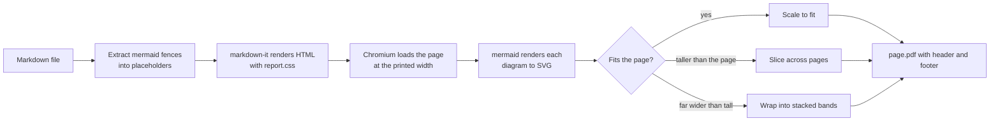

# markdown-to-pdf

Renders a Markdown file to a paginated PDF in headless Chromium, with mermaid
diagrams drawn as vector SVG, table headers repeated on continuation pages and a
running header and `Page N of M` footer on every page.

Claude loads `SKILL.md` when asked to turn Markdown into a PDF. The script also
runs on its own.

## Requirements

- Node.js 20.19 or later (`engines` in `package.json`). The pinned `playwright-core`
  requires Node 20 and its `entities` dependency requires 20.19.0.
- A Chromium build. `md2pdf.js` checks `CHROME_PATH`, then the Playwright browser
  cache, then common system Chrome and Chromium paths. To install the build that
  matches the pinned `playwright-core`, run `npm ci` and then
  `npx playwright-core install chromium` in this folder.

## Usage

```bash
npm ci --prefix ~/.claude/skills/markdown-to-pdf    # optional; the first render installs
node ~/.claude/skills/markdown-to-pdf/md2pdf.js report.md report.pdf --note "Draft" --format A4
```

| Option | Effect |
|---|---|
| `--note "TEXT"` | Right-hand running-header text |
| `--format Letter\|A4` | Paper size, default `Letter` |
| `--landscape` | Landscape orientation |

The script prints one line per output file and one line per diagram that was
sliced, banded or left below the legibility scale.

## How it works



The thresholds are constants at the top of `md2pdf.js` (`LEGIBLE_SCALE`,
`TARGET_SCALE`, `MAX_BANDS`) and in `window.renderAll`. The reasons for the
narrow page margins and the stripped mermaid inline sizes are in `SKILL.md`,
section "Design notes".

## Tests

```bash
npm ci
npm test
```

`test/smoke.test.js` renders `test/fixtures/sample.md` (a heading, a table and
one flowchart) and checks the `%PDF` header and the reported diagram count,
renders `test/fixtures/tall.md` and checks that the diagram is sliced across
pages, and checks that an unknown option exits 1.

## Limitations

- A narrow, tall diagram is scaled up to the column width before it is sliced,
  so `test/fixtures/tall.md` (a 31-node vertical chain) prints as one enlarged
  diagram across many pages. The upscale is not capped.
- Layout problems that do not raise an error, such as a clipped table, are not
  detected. `SKILL.md` tells Claude to render pages to PNG and inspect them.
- markdown-it runs with `html: true`, so raw HTML in the Markdown reaches the
  rendered page. Treat the Markdown as trusted input.
